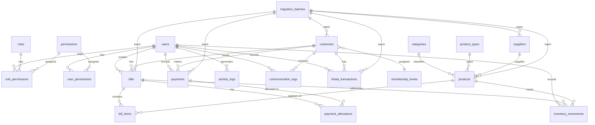

# JWELLERS EDITH — Database Architecture Report

**Author:** AD's Creation
**Version:** 1.0.0
**Date:** July 2026

---

## A. OVERALL DESIGN

### Architecture Pattern

```
UI (React/Electron)
        ↓
Service / Business Logic Layer
        ↓
Repository / Data Access Layer
        ↓
SQLite Database (sql.js via Node.js)
```

### Key Design Decisions

| Decision | Choice | Rationale |
|----------|--------|-----------|
| Database Engine | SQLite (via sql.js) | Offline-first, zero configuration, single-file, no server |
| DB Library | sql.js | Pure JavaScript/WASM — no native compilation needed; works cross-platform without C++ build tools |
| Foreign Keys | Enforced via PRAGMA | Referential integrity guaranteed at DB level |
| Transactions | BEGIN IMMEDIATE + COMMIT/ROLLBACK | Prevents concurrent write conflicts; all-or-nothing business operations |
| Schema Versioning | schema_migrations table | Supports future upgrades without data loss |
| Soft Deletes | is_deleted flag | Preserves history; reversible by owner |
| Historical Data | data_source, migration_batch_id, original_date fields | Distinguishes migrated/legacy data from live transactions |
| Invoice Numbers | Customizable prefix + auto-increment | No duplicates; user-configurable format |
| Backup | File-level copy with SHA-256 verification | Consistent, verifiable, portable |

### 24 Tables (excluding sqlite_sequence)

1. **users** — Authentication and staff accounts
2. **roles** — Role definitions (owner, staff)
3. **permissions** — Granular permission codes
4. **role_permissions** — Role-to-permission assignments
5. **user_permissions** — Per-user permission overrides
6. **shop_settings** — Single-row shop configuration
7. **app_settings** — Single-row application settings
8. **customers** — Customer records
9. **membership_levels** — Configurable loyalty tiers
10. **categories** — Jewellery metal categories
11. **product_types** — Jewellery type classification
12. **products** — Inventory items
13. **suppliers** — Vendor records
14. **inventory_movements** — Stock change history
15. **bills** — Invoice headers (GST & Non-GST)
16. **bill_items** — Invoice line items
17. **payments** — Payment records
18. **payment_allocations** — Payment-to-bill mapping
19. **khata_transactions** — Customer ledger entries
20. **communication_logs** — WhatsApp/SMS history
21. **activity_logs** — Audit trail
22. **backup_history** — Backup metadata
23. **schema_migrations** — DB version tracking
24. **migration_batches** — Batch import tracking

---

## B. FINAL TABLE LIST — Purpose & Explanation

### users
Staff/owner accounts. Passwords stored as SHA-256 hashes. Linked to roles for permission inheritance. Supports `is_active` flag for disabling accounts without deletion.

### roles
System roles (`owner`, `staff`) created during initialization. `is_system` flag prevents accidental deletion. Owner role has all permissions; staff role has limited permissions configurable by owner.

### permissions
Fine-grained action codes (e.g., `customer.create`, `bill.cancel`, `backup.restore`). Grouped by module for UI organization. Used by `role_permissions` for role-based access control.

### role_permissions
Many-to-many join. Owner gets all permissions. Staff permissions are assigned selectively. Enables role-based access control without per-user complexity.

### user_permissions
Optional per-user permission overrides. Allows granting or denying specific permissions to individual staff members beyond their role. `is_granted` field (1=grant, 0=deny).

### shop_settings
Single-row table (enforced by `CHECK(id=1)`). Contains shop name, GST/PAN numbers, invoice numbering configuration, currency, date format, and backup preferences. All fields optional except currency and invoice numbering defaults.

### app_settings
Single-row table. Tracks schema version, app version, DB creation time, Google Drive token (encrypted), theme preference, and language. Separated from shop_settings because app settings are technical while shop settings are business data.

### customers
Core customer data with `customer_id` (display ID, unique, auto-generated or manual). Supports two phone numbers, Aadhaar (optional), membership level, and soft-delete/archive. `data_source` field distinguishes live vs migrated customers.

### membership_levels
Configurable tiers (Regular, Silver, Gold, Platinum, VIP). Supports custom discount percentage per level. `is_default` for the default level assigned to new customers.

### categories
Four default categories: Gold, Silver, Diamond, Platinum. Configurable by owner. Used for product classification and reporting.

### product_types
Configurable jewellery types (Ring, Chain, Necklace, etc.). Separate from categories because categories are metals and product types are forms.

### products
Inventory items. Supports metal, purity, weight (gross/net/stone), making charges, wastage, pricing, and stock quantity. Optional references to category, product type, and supplier. `is_active`/`is_deleted` flags. `data_source` for migrated products.

### suppliers
Vendor records with display ID, contact info, and soft-delete. Products optionally reference suppliers.

### inventory_movements
Every stock change recorded immutably. Movement types constrained by CHECK: `opening_stock`, `purchase_added`, `sold`, `returned`, `repair`, `exchange`, `damaged`, `lost`, `manual_adjustment`. Tracks quantity before/after change. Links to related bill and user.

### bills
Unified invoice table for both GST and Non-GST invoices. `bill_type` CHECK constraint (`gst`, `non_gst`). Stores all monetary snapshot values (subtotal, discounts, tax components, grand total) immutably. Tracks payment status (`unpaid`, `partial`, `paid`). `status` field supports cancellation. HSN codes and tax rates stored as historical snapshots.

### bill_items
Line items supporting both inventory items (`item_type='inventory'`, has `product_id`) and manual/custom entries (`item_type='manual'`, no `product_id`). Each item stores its own weight, making charge, wastage, tax, and total as immutable snapshots. `ON DELETE CASCADE` from bills.

### payments
Payment records linked to customer. Supports methods (`cash`, `upi`, `card`, `other`) and types (`bill_payment`, `khata_payment`, `opening_balance`, `refund`, `adjustment`). Multiple payments can exist for the same customer.

### payment_allocations
Maps payments to specific bills. Enables split payments (one payment covering multiple bills) and partial payments (multiple payments for one bill). `UNIQUE(payment_id, bill_id)` prevents duplicate allocations.

### khata_transactions
Complete customer ledger. Each entry has `debit` (amount owed) and `credit` (amount paid) columns with running `balance`. Transaction types: `bill`, `payment`, `opening_balance`, `adjustment_debit`, `adjustment_credit`, `refund`. Links to related bill/payment. `data_source` for migrated entries.

### communication_logs
Records all outbound WhatsApp/SMS messages. Tracks type (`whatsapp`, `sms`), message type (`invoice`, `payment_confirmation`, `khata_reminder`, `custom`), status (`sent`, `failed`, `pending`), and error details. Links to customer, bill, and payment.

### activity_logs
Immutable audit trail for all important actions (login, bill created, payment received, etc.). Stores user, action, entity reference, description, and JSON metadata. Protected from staff modification.

### backup_history
Records every backup with type, location, file hash (SHA-256), size, schema/app version, and verification status. Enables audit of backup operations.

### schema_migrations
Tracks all applied schema versions for safe upgrades. Stores checksum, timestamps, duration, and success status. Enables forward-only migration pattern.

### migration_batches
Groups related imported/migrated records together. Referenced by `migration_batch_id` in customers, products, suppliers, bills, payments, and khata_transactions.

---

## C. COMPLETE SCHEMA

See `database/schema.sql` for the full DDL with all columns, types, constraints, and indexes.

Key design patterns:
- **All tables use INTEGER PRIMARY KEY AUTOINCREMENT** for internal IDs
- **Display IDs** (customer_id, invoice_number, supplier_id) are separate TEXT fields with UNIQUE constraints
- **Timestamps** use SQLite's `datetime('now', 'localtime')` text format
- **Soft deletes** use `is_deleted INTEGER DEFAULT 0` flags
- **Data lineage** uses `data_source TEXT CHECK(...)`, `migration_batch_id`, and `original_date`

---

## D. RELATIONSHIP DIAGRAM (ERD)



---

## E. INDEX STRATEGY

| Table | Index | Columns | Purpose |
|-------|-------|---------|---------|
| bills | idx_bills_customer | customer_id | Fast customer bill history lookup |
| bills | idx_bills_user | user_id | Staff activity queries |
| bills | idx_bills_date | bill_date | Date-range filtering, reports |
| bills | idx_bills_type | bill_type | GST vs Non-GST filtering |
| bills | idx_bills_status | status | Active/cancelled filtering |
| bills | idx_bills_payment_status | payment_status | Paid/unpaid/partial filtering |
| bills | idx_bills_invoice | invoice_number | Fast invoice lookup |
| bill_items | idx_bill_items_bill | bill_id | Line items for a bill |
| bill_items | idx_bill_items_product | product_id | Product sales history |
| customers | idx_customers_phone1 | phone1 | Phone search |
| customers | idx_customers_phone2 | phone2 | Secondary phone search |
| customers | idx_customers_city | city | City-based filtering |
| customers | idx_customers_name | name | Name search |
| customers | idx_customers_membership | membership_level_id | Membership reports |
| customers | idx_customers_archived | is_archived | Archived customers filter |
| customers | idx_customers_deleted | is_deleted | Soft-delete filter |
| products | idx_products_category | category_id | Category reports |
| products | idx_products_type | product_type_id | Product type reports |
| products | idx_products_supplier | supplier_id | Supplier products |
| products | idx_products_name | product_name | Name search |
| inventory_movements | idx_inv_mov_product | product_id | Product movement history |
| inventory_movements | idx_inv_mov_type | movement_type | Movement type reports |
| inventory_movements | idx_inv_mov_bill | bill_id | Bill-related movements |
| khata_transactions | idx_khata_customer | customer_id | Customer ledger query |
| khata_transactions | idx_khata_date | transaction_date | Date range filtering |
| khata_transactions | idx_khata_type | transaction_type | Transaction type reports |
| payments | idx_payments_customer | customer_id | Customer payment history |
| payments | idx_payments_user | user_id | Staff payment records |
| payments | idx_payments_date | payment_date | Date-range filtering |
| activity_logs | idx_activity_user | user_id | User activity filtering |
| activity_logs | idx_activity_date | created_at | Date-range query |
| communication_logs | idx_comm_customer | customer_id | Customer communication history |

---

## F. DELETE / ARCHIVE STRATEGY

### Soft Delete

Tables with soft-delete support (`is_deleted` flag):
- `customers`
- `products`
- `suppliers`

For these records, deletion sets `is_deleted = 1` and `updated_at`. The record remains in the database for historical reference but is hidden from default queries.

### Archive

Tables with archive support (`is_archived` flag):
- `customers`

Archiving hides a customer from active lists while preserving their data. Archived customers can be restored.

### Bill Reversal (not deletion)

Bills should never be deleted. Instead:
1. Set `status = 'cancelled'` (or `'reversed'`)
2. Record `cancellation_reason`
3. Create reversal khata transactions
4. Reverse inventory movements if applicable
5. Log in activity_logs

### Permanent Deletion

Only when explicitly allowed:
- Requires owner permission
- Respects foreign-key relationships
- Audited via activity_logs
- Recommended only for test data or incorrectly entered records (not financial records)

---

## G. TRANSACTION STRATEGY

### Atomic Bill Finalization

```sql
BEGIN IMMEDIATE TRANSACTION
  1. INSERT INTO bills
  2. INSERT INTO bill_items (for each item)
  3. INSERT INTO payments (if payment received)
  4. INSERT INTO payment_allocations
  5. UPDATE products SET quantity_in_stock (for inventory items)
  6. INSERT INTO inventory_movements (for each inventory item)
  7. INSERT INTO khata_transactions (debit for bill)
  8. INSERT INTO khata_transactions (credit for payment, if applicable)
  9. INSERT INTO activity_logs
COMMIT
```

If any step fails → ROLLBACK → no partial data.

### TransactionManager API

- `TransactionManager.execute(callback)` — Wraps in BEGIN/COMMIT/ROLLBACK
- `TransactionManager.executeWithSavepoint(name, callback)` — Nested transactions via savepoints

### Usage Rules

1. Every multi-table write operation uses transactions
2. Financial operations (bills, payments, khata adjustments) MUST use transactions
3. Inventory movements MUST use transactions
4. Never nest transactions without savepoints
5. Always catch transaction errors and log them

---

## H. MIGRATION STRATEGY

### Versioning

- `schema_migrations` table tracks all applied versions
- Each migration is a numbered `.sql` file in `database/migrations/`
- File naming: `{version}_{description}.sql` (e.g., `002_add_product_images.sql`)

### Migration Flow

1. App starts → checks current schema version
2. Scans `database/migrations/` for unapplied files
3. Applies each migration in version order within a transaction
4. Records each migration with checksum, timestamp, duration
5. If migration fails → full rollback, app alert

### Adding New Features

1. Create new migration file with version number
2. Use `ALTER TABLE` or `CREATE TABLE` as needed
3. Never modify existing migration files (immutable)
4. Test migration on a copy of demo database

### Safe Upgrade Rules

- Never delete columns (use `is_deleted` or archive instead)
- Never remove tables (even if unused, migration must handle gracefully)
- Always backup before migration
- Migration failures are reversible by restoring pre-migration backup

---

## I. BACKUP STRATEGY

### Local Backup (Type 1)

1. User selects destination (USB drive, external HDD, folder)
2. System calls `db.backup(backupPath)` which:
   - Exports the full in-memory database to the source file
   - Copies the file to the destination
3. SHA-256 hash calculated for verification
4. Backup metadata recorded in `backup_history`
5. `app_settings.last_backup_at` updated

### Cloud Backup (Type 2 — Future)

- Google Drive API integration
- User authenticates with their own Google account
- Backup file uploaded to user's Google Drive
- OAuth tokens stored encrypted in `app_settings.google_drive_token_enc`
- No Gmail storage — only Google Drive

### Verification

- Every backup is verified with SHA-256 checksum
- Verification status recorded (`verified`, `failed`, `not_verified`)
- Restore requires owner permission
- Pre-restore verification prevents corrupted restores

### Safety Rules

- Never overwrite the only known good backup
- Multiple backup versions maintained
- Backup before any schema migration
- Restore creates activity log entry

---

## J. SECURITY REVIEW

| Risk | Mitigation |
|------|-----------|
| SQL Injection | Parameterized queries in all prepared statements. NEVER concatenate user input into SQL. |
| Weak Passwords | SHA-256 password hashing (upgrade to bcrypt/scrypt in future). Minimum length validation in service layer. |
| Unauthorized Access | Role-based access control. Owner has full access; staff has limited permissions per role_permissions. |
| Stale Sessions | `last_login_at` tracking. Future: session tokens with expiry. |
| Data Tampering | Immutable bill/payment records via snapshot fields. Changes require reversal (not deletion). |
| Unauthorized Deletion | Soft-delete default. Permanent delete requires owner role. |
| Backup Integrity | SHA-256 checksums on all backups. Verification before restore. |
| Configuration Secrets | Google Drive tokens stored encrypted. API keys in secure config, not database. |
| Audit Evasion | `activity_logs` records all critical actions. Owner-only deletion of logs (future feature). |
| Local DB Theft | Future: SQLite encryption extension. Note: encryption protects data at rest but not from application-layer access. |
| Race Conditions | `BEGIN IMMEDIATE` transactions prevent write conflicts. WAL mode enables concurrent reads during writes. |

### Password Security

Current: SHA-256 (adequate for local desktop app with physical access control).
Recommendation for future: Upgrade to bcrypt with salt rounds for production release.

### What Encryption Protects

- Google Drive tokens (encrypted at rest in app_settings)
- Database file via SQLite Encryption Extension (future)

### What Encryption Does NOT Protect

- Data accessed through the application (decrypted in memory)
- Screenshots or screen capture
- Physical access to the machine
- Keylogger/malware on the host machine

---

## K. DEMO DATA STRATEGY

### Separation

- Production DB path: `%APPDATA%\.jwellers-edith\data\jwellers_edith.db`
- Demo DB path: `./demo_jwellers_edith.db` (project root)
- Completely separate database files
- Demo data never mixes with production

### Demo Credentials

| User | Username | Password | Role |
|------|----------|----------|------|
| Owner | owner | owner123 | Full access |
| Staff | staff | staff123 | Limited access |

### Demo Data Content

- Shop: "Shree Jewellers", Mumbai
- 30 customers (25 live + 5 migrated)
- 12 products across Gold, Silver, Diamond, Platinum
- 5 suppliers
- 5 membership levels
- 12 bills (8 GST + 4 Non-GST) with various payment statuses
- Partial payments, unpaid bills, fully paid bills
- Migrated customers with opening khata balances
- Communication logs
- Activity logs
- Backup history
- Complete permissions structure
- Inventory movements

### Data Integrity Rules for Demo

- No real personal information used
- Phone numbers use test/sequential patterns
- GST numbers follow format but are fictional
- All data self-contained within demo database
- Demo can be reset by deleting the demo file and re-running seed

---

## PROJECT STRUCTURE

```
D:\jwelles edith\
├── package.json
├── .gitignore
├── database/
│   ├── schema.sql              # Complete DDL
│   ├── connection.js            # DB connection manager
│   ├── sqlite_shim.js           # sql.js compatibility layer
│   ├── transaction_manager.js   # Atomic operation wrapper
│   ├── migration_manager.js     # Schema versioning
│   ├── backup_manager.js        # Backup/restore operations
│   ├── init.js                  # Production initialization
│   ├── ARCHITECTURE_REPORT.md   # This document
│   ├── migrations/              # Future migration files
│   └── seeds/
│       └── seed_demo.js         # Demo data seed
├── repositories/
│   └── base_repository.js       # Generic CRUD repo
├── services/                    # Future service layer
├── backend/                     # Future Electron main process
├── frontend/                    # Future React UI
├── config/                      # Future configuration
├── tests/
│   └── database.test.js         # 86 automated tests
└── scripts/
    ├── reset_db.js              # Database cleanup
    └── verify_demo.js           # Demo verification
```

## TEST RESULTS

```
=== RESULTS: 86 passed, 0 failed ===
```

Test coverage includes:
- Database creation and all 24 tables ✓
- Foreign key enforcement ✓
- UNIQUE constraint violations ✓
- Customer CRUD ✓
- Duplicate customer ID prevention ✓
- Bill creation within atomic transactions ✓
- Transaction rollback on failure (no orphan data) ✓
- Inventory stock updates with movement records ✓
- Manual/custom bill items (no product reference) ✓
- Partial payment with multiple payment allocations ✓
- Khata running balance calculations ✓
- Migrated historical data with opening balances ✓
- Schema versioning and migration tracking ✓
- BaseRepository CRUD operations ✓
- CHECK constraint enforcement (bill_type, status) ✓
- Single-row enforcement (shop_settings, app_settings) ✓
- All indexes created ✓
- Activity log creation ✓
- Backup creation with SHA-256 verification ✓
